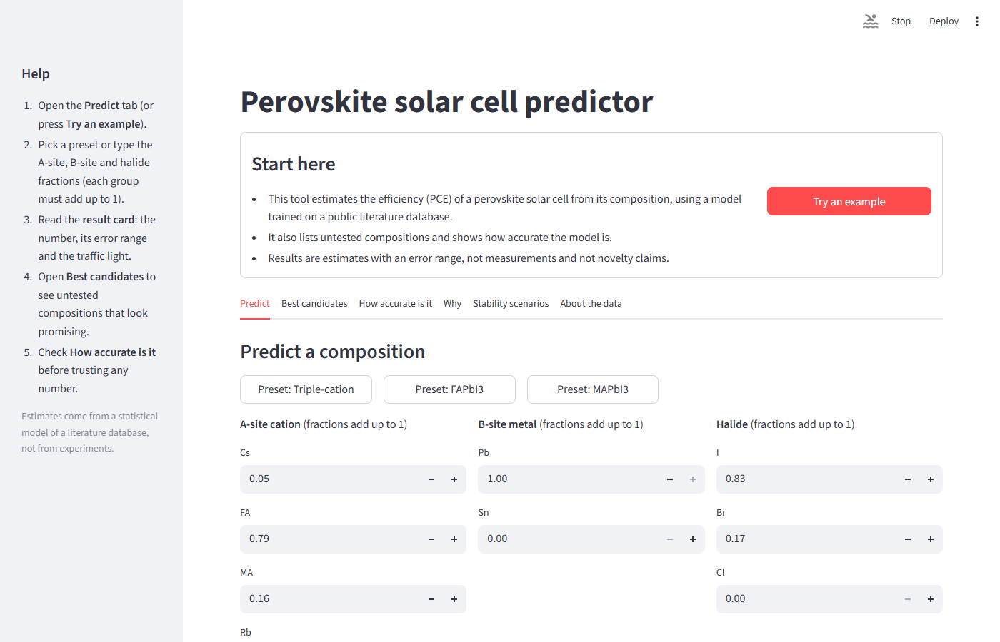
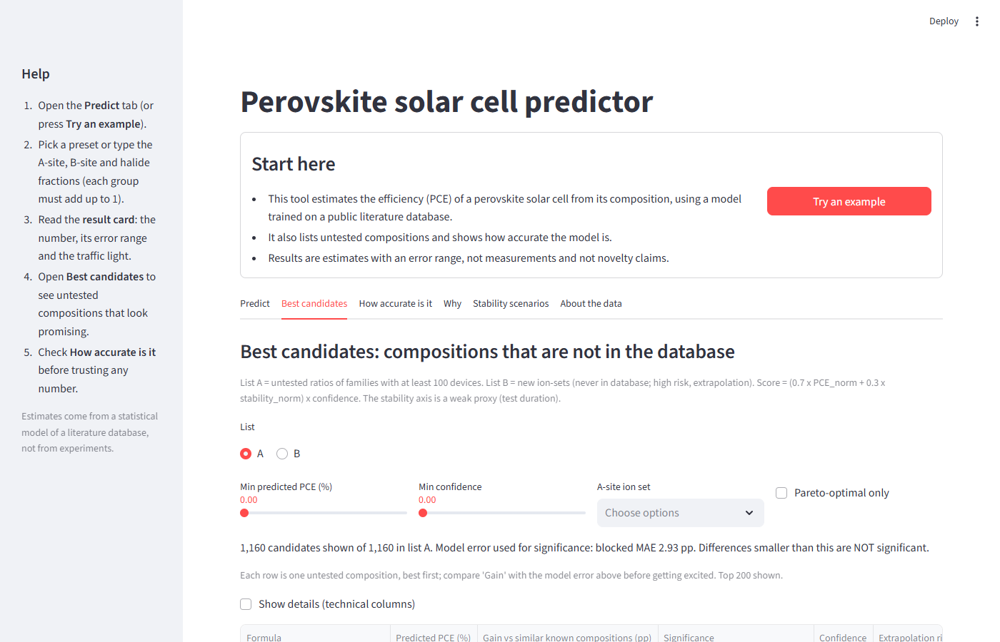

# Perovskite PCE Dashboard

ML screening dashboard that predicts perovskite solar cell power conversion efficiency (PCE) and a stability proxy from composition, device stack and processing conditions.

[](../../actions/workflows/ci.yml)





## Features
- Predict PCE, Voc, Jsc and FF for a user-defined device, with an error range and a physics-route confidence.
- Ranked candidate compositions (screening lists) with a database-status column and an extrapolation flag.
- Accuracy tab (random vs blocked evaluation), SHAP/partial-dependence explanations, stability scenarios.
- Runs offline from the precomputed `model_store/`; optional `APP_PASSWORD` gate.

Live demo: _link to be added after the Render deploy_

## Quickstart
```bash
pip install -r requirements.txt
python -m pytest -q          # optional, needs requirements-dev.txt
streamlit run dashboard/app.py
```

## Method summary
- **Inputs (87 features):** perovskite composition (A/B/X site ions and ratios, derived tolerance and octahedral factors), layer stack, deposition and processing conditions. Data come from the Perovskite Database Project (see attribution).
- **Targets:** PCE, Voc, Jsc, FF (XGBoost regressors) and a stability proxy model.
- **No-leakage rule:** PCE inputs never contain Voc, Jsc, FF or PCE; enforced by `assert_no_leakage` and checked in `model_store/results/final_audit.csv`.
- **Physics route:** PCE = Voc x Jsc x FF is also computed from the three predicted parameters. Confidence is 1 minus the relative gap between the direct PCE prediction and the physics-route PCE, clipped to [0, 1].
- **Evaluation:** random 80/20 split versus a blocked 80/20 split (blocks of consecutive database rows, an approximation of study-wise grouping, not paper-wise). Metrics are from `model_store/metrics_targets.csv`:

| PCE model | Random R2 | Random MAE (pp) | Blocked R2 | Blocked MAE (pp) |
|---|---|---|---|---|
| Direct | 0.623 | 2.35 | 0.457 | 2.93 |
| Voc x Jsc x FF | 0.595 | 2.45 | 0.416 | 3.03 |
| Average of both | 0.616 | 2.38 | 0.449 | 2.97 |

Test sizes: 9,383 (random) and 9,238 (blocked). Blocked cross-validation folds are in `model_store/cv_blocked_pce.csv`; per-family results in `model_store/leave_family_out.csv`.

## Limitations
- The stability column is the test duration reported in the source data (a proxy), not a measured lifetime.
- Outputs are screening aids, not experimental validation.
- Predictions are compressed toward the mean: the blocked-set slope of predicted vs actual PCE is 0.468 (`model_store/pce_shrinkage.json`), and the highest predictions are below the highest observed values.
- "Not in database" means only that no device with the same ion set and ratios (within a tolerance of 0.03) exists in the Perovskite Database Project snapshot used. No literature search was done and it is not a claim of originality.
- Per the audit (`model_store/results/final_audit.csv`), 86.93 % of random-split test rows have a feature vector that also appears in training (54.73 % for the blocked split); these are different devices with the same composition, stack and conditions. This inflates the random-split score, so the blocked numbers are the more realistic ones.

## Repository layout
```
dashboard/   Streamlit app
pv2/         core feature, model and candidate logic; store loader
pipeline/    training/export and audit scripts
tests/       pytest suite (needs only model_store/)
model_store/ runtime artifacts (models, tables, metrics)
docs/        screenshots
```

## Retrain
Download the Perovskite Database Project data separately (not included), then:
```bash
python pipeline/train_export.py --raw <path-to-database.csv> --p3 <stability-table.csv> --out model_store
```
Training takes roughly 10 minutes on a laptop CPU (the last full run took 640 s). Use `--smoke` for a quick check. See `pipeline/train_export.py` for details of the stability table.

## Data attribution
Data derive from the Perovskite Database Project, https://www.perovskitedatabase.com (CC BY 4.0). Reference: Jacobsson, T. J. et al., "An open-access database and analysis tool for perovskite solar cells based on the FAIR data principles", Nature Energy 7, 107-115 (2022), doi:10.1038/s41560-021-00941-3. See `DATA_LICENSE.md`.

## How to cite
Use `CITATION.cff` for the software, and cite the Perovskite Database Project paper above for the data.

## Disclaimer
Research prototype provided as is, without warranty. Predictions are statistical estimates and must be confirmed experimentally. Deployment: see `DEPLOY.md`.
